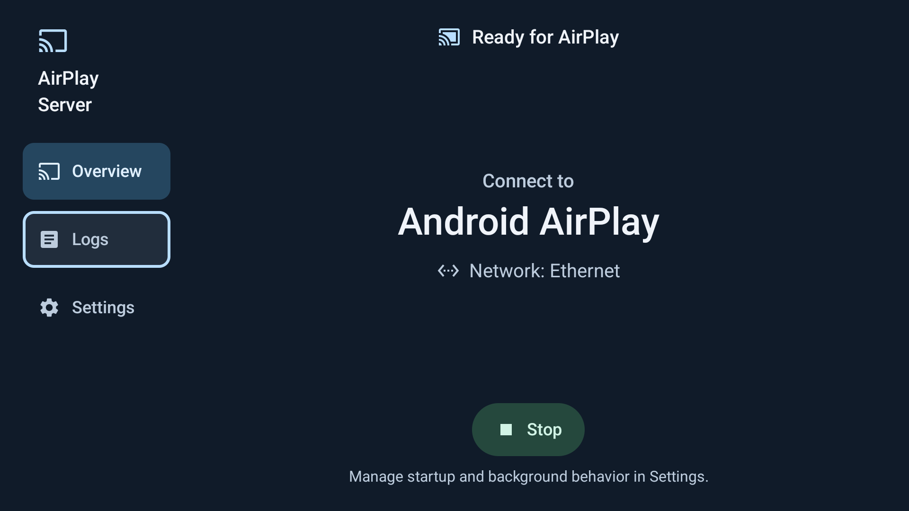
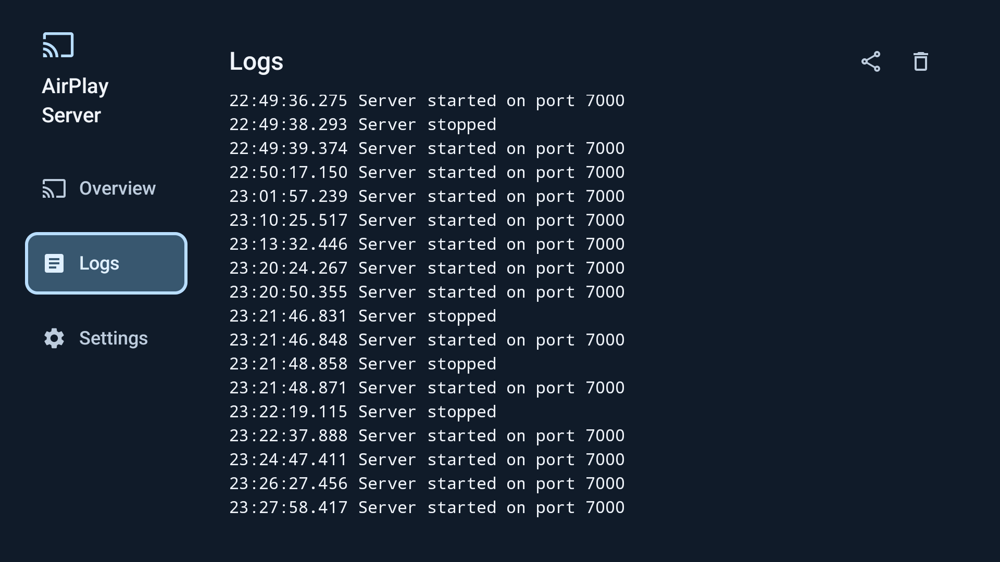
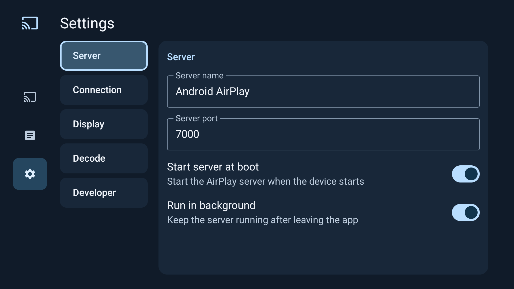
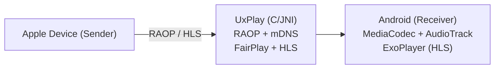

# AirPlay TV for Android

[](LICENSE)

This repository is a fork of [jqssun/android-airplay-server](https://github.com/jqssun/android-airplay-server), the original AirPlay Receiver for Android project. It keeps the upstream AirPlay receiver and adds a TV-focused interface with remote-friendly navigation, a clear receiver/network overview, and full-screen pairing codes.

The free and open-source receiver turns an Android device into an AirPlay-compatible display and speaker using [UxPlay](https://github.com/FDH2/UxPlay). It works with iOS, iPadOS, macOS, and compatible third-party senders. The network-name display and passcode tiles are inspired by [Jheenz/airplay-tv-receiver](https://github.com/Jheenz/airplay-tv-receiver), specifically [v0.1.8](https://github.com/Jheenz/airplay-tv-receiver/releases/tag/v0.1.8), adapted to this fork's own UI rather than replacing it.

## Downloads

To use **this fork's TV interface**, build the APK from this repository using the instructions below. The store links and demo here belong to the **original upstream app**, not this fork:

[](https://play.google.com/store/apps/details?id=io.github.jqssun.airplay)
[](https://f-droid.org/packages/io.github.jqssun.airplay)
[](https://github.com/jqssun/android-airplay-server/releases/latest)



### Logs



### Settings



Screenshots show this fork running in the Android TV emulator.

## Compatibility

- The APK's minimum Android version is Android 6.0 (API 23), including Android TV; individual playback and system features depend on the Android version and device hardware.
- AirPlay devices on the same subnet, including iOS/iPadOS, macOS devices, or other sender implementations
- Builds include `arm64-v8a`, `armeabi-v7a`, and `x86_64` architectures.

## Features

### TV interface added in this fork

- A TV-specific dark theme, large readable typography, overscan-safe margins, and clear directional-pad focus outlines; the phone interface is retained.
- An Overview, Logs, and Settings navigation rail that expands to show labels when focused and collapses to icons when focus moves into the page.
- Focus-to-select navigation: highlighting a sidebar page or settings category opens it immediately, without pressing OK.
- Predictable remote Back navigation: return from content to the current sidebar item, then to Overview, then leave the app.
- An uncluttered Overview showing receiver status, the configured receiver name, the current network, and Start/Stop controls, without step-by-step mirroring instructions.
- Wi-Fi SSID display when Android permits it, with an optional permission action; Ethernet, disconnected, and unavailable states are shown separately. Revealing the SSID requires location permission and Location enabled on Android.
- Full-screen AirPlay PIN tiles with large individual digits, connection instructions, screen-reader labeling, and remote Back dismissal.
- Settings grouped into Server, Connection, Display, Decode, and Developer categories. TV developer controls are directly accessible without a redundant enable switch.

### AirPlay and playback

- Screen mirroring with H.264 and H.265 (HEVC) video decoding.
- Audio streaming with AAC-ELD, AAC-LC, and ALAC decoding, including software decoder options for AAC and ALAC.
- Video playback including HLS streaming, downloads, playback controls, seeking, playback-speed adjustment, silence skipping, and video URL copying.
- Video-player controls for orientation, zoom/content scaling, control locking, and volume/brightness gestures where applicable, plus directional-pad navigation and seeking.
- Music playback with track information, cover art, play/pause, previous/next, rewind/fast-forward, and sender/receiver volume controls.
- Picture-in-Picture on supported devices, automatic mirroring fullscreen, idle preview, and automatic resolution/mode switching.
- Android media-session integration and notification playback controls.
- Wired secondary-display use with macOS/iPadOS over USB tethering, including USB-only discovery.

### Receiver and connection management

- Configurable receiver name and server port, manual Start/Stop, automatic start on app launch or device boot, and background operation.
- Optional four-digit PIN authentication (beta) and a setting controlling whether a new connection can replace the current sender.
- Independent advertisement of video, screen-mirroring, audio, AAC, and ALAC support.
- Launch-on-connect and keep-screen-on options, subject to the required Android permissions.
- ADB access to read and change all exposed preferences through a permission-protected settings receiver.

### Display, audio tuning, and diagnostics

- Automatic, portrait, landscape, or custom advertised resolution; maximum frame rate and overscan controls.
- H.265 selection and SDR tagging, decoder frame-dropping, real-time priority, operating-rate, and VSYNC-aligned frame-release options.
- Low-latency audio decoding, advertised audio-delay override, adaptive or fixed software audio buffering, and hardware output-buffer tuning.
- Sender-volume synchronization or independent sender/receiver volume behavior.
- Real-time debug statistics including codec, resolution, FPS, bitrate, jitter, frame/drop counts, audio buffering/decoding, volume, and connections.
- An in-app log viewer with export/clear actions and optional stream-statistics logging to logcat.

> [!WARNING]
> DRM content (e.g. from the Apple TV application) is not supported.

> [!NOTE]
> An Android TV emulator is useful for UI testing, but discovery alone does not guarantee AirPlay connectivity through emulator networking. Test actual streaming on a physical Android device on the same network as the sender.

## Build and install this fork

Install a compatible JDK and Android SDK, then initialize the native dependencies and build:

```bash
git submodule update --init --recursive
./gradlew assembleDebug
```

Set `ANDROID_HOME` to your SDK directory if it is not already configured. The project uses Android SDK 37 and NDK `27.0.12077973`; see [`app/build.gradle.kts`](app/build.gradle.kts) for the current build configuration.

The debug APK is written to `app/build/outputs/apk/debug/app-debug.apk`. To install it on a selected device:

```bash
adb devices
adb -s DEVICE_SERIAL install -r app/build/outputs/apk/debug/app-debug.apk
adb -s DEVICE_SERIAL shell am start -n io.github.jqssun.airplay/.MainActivity
```

This fork retains the upstream application ID, `io.github.jqssun.airplay`, so it cannot be installed alongside the original app or another fork with that ID. A different signing key prevents an in-place update, and a lower version code may also block installation. Back up your settings before choosing to uninstall an existing app: uninstalling removes app data and permissions. The ADB commands below can read exposed settings, but restoring them requires writing their values back; there is no automatic backup/import step in these commands.

## Configure from ADB

On devices without a display, settings can also be changed over ADB. The receiver is protected by `android.permission.DUMP` so regular installed apps cannot change them. Values are passed as text using `--es`. Using `adb shell`:

```bash
export KEY="server_name" VALUE="Speaker"
am broadcast -n io.github.jqssun.airplay/.SettingsReceiver -a io.github.jqssun.airplay.SET_SETTING --es key "$KEY" --es value "$VALUE"
```

To list all settings with their current values as JSON:

```bash
am start -n io.github.jqssun.airplay/.MainActivity
am broadcast -n io.github.jqssun.airplay/.SettingsReceiver -a io.github.jqssun.airplay.LIST_SETTINGS
```

## Implementation

This application uses the C-based [UxPlay](https://github.com/FDH2/UxPlay) library to implement the AirPlay/RAOP protocol, with a JNI bridge to the Android application layer. Audio can be decoded via MediaCodec or a software ALAC decoder, while mirroring video is decoded via MediaCodec and rendered to a SurfaceView. HLS sessions are served through a local playlist proxy.

When using USB tethering, the Android device can act as a reliable secondary display over a wired connection. Apple devices natively support USB tethering over CDC-NCM, so on Android devices that default to RNDIS, you may need to switch to CDC-NCM over ADB:

```bash
adb shell settings put global tether_force_usb_functions 1
```



CMake is used for native C/C++ components under [`app/src/main/cpp`](app/src/main/cpp). See the [build workflow](.github/workflows/apk.yml) for the repository's CI build configuration.

## Credits

- [jqssun/android-airplay-server](https://github.com/jqssun/android-airplay-server) — the original Android AirPlay receiver, its contributors, and the foundation for this fork's protocol, playback, service, and settings implementation.
- [Jheenz/airplay-tv-receiver](https://github.com/Jheenz/airplay-tv-receiver) — inspiration and reference for the network/receiver overview and full-screen AirPlay passcode tiles, particularly [release v0.1.8](https://github.com/Jheenz/airplay-tv-receiver/releases/tag/v0.1.8). This fork keeps its own TV layout and navigation.
- [UxPlay](https://github.com/FDH2/UxPlay) for the AirPlay/RAOP server implementation
- [FFmpeg](https://ffmpeg.org) for the lossless audio decoder
- [Next Player](https://github.com/anilbeesetti/nextplayer) for the video player

This fork remains licensed under [GPLv3](LICENSE).

---

Disclaimer: This project is not affiliated with Apple Inc.
